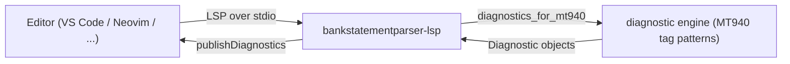

<!-- SPDX-License-Identifier: Apache-2.0 OR MIT -->

<p align="center">
  
</p>

<h1 align="center">bankstatementparser-lsp</h1>

<p align="center">
  Language server that lints MT940 bank-statement files as you type, flagging missing tags and malformed balance, statement and information lines in any LSP editor.
</p>

<p align="center">
  <a href="https://github.com/sebastienrousseau/bankstatementparser-lsp/actions"></a>
  <a href="https://pypi.org/project/bankstatementparser-lsp/"></a>
  <a href="https://sebastienrousseau.com/bankstatementparser-lsp/"></a>
  <a href="https://scorecard.dev/viewer/?uri=github.com/sebastienrousseau/bankstatementparser-lsp"></a>
  <a href="LICENSE"></a>
  <a href="https://github.com/sebastienrousseau/bankstatementparser-lsp/blob/main/docs/POLICIES.md"></a>
</p>

<p align="center">
  
</p>

---

## Contents

**Getting started**

- [Install](#install): PyPI, source, Docker (GHCR)
- [Requirements](#requirements): toolchain floor, platforms
- [Quick Start](#quick-start): wire it to your editor

**The bankstatementparser-lsp ecosystem**

- [The bankstatementparser-lsp ecosystem](#the-bankstatementparser-lsp-ecosystem): the core library, the MCP server, the loaders and writers

**Library reference**

- [Capabilities at a glance](#capabilities-at-a-glance): the current surface by theme
- [Ecosystem comparison](#ecosystem-comparison): short matrix; full table at [`docs/COMPARISON.md`](docs/COMPARISON.md)
- [Benchmarks](#benchmarks): headline numbers; full table at [`docs/BENCHMARKS.md`](docs/BENCHMARKS.md)
- [Features](#features): the four diagnostic rules
- [Configuration](#configuration): core options
- [Examples](#examples): runnable example index

**Operational**

- [When not to use bankstatementparser-lsp](#when-not-to-use-bankstatementparser-lsp): limitations
- [Development](#development): make targets, fuzzing, CI
- [Security](#security): guarantees and compliance
- [Documentation](#documentation): all reference docs
- [Stability guarantees](#stability-guarantees): SemVer axis, output stability, minimum toolchain discipline
- [License](#license)

---

## Install

### As a Python library

```bash
pip install bankstatementparser-lsp
```

That installs the `bankstatementparser-lsp` command, `bankstatementparser >= 0.0.36` and `pygls`.

| Channel | Command | Notes |
| :--- | :--- | :--- |
| PyPI | `pip install bankstatementparser-lsp` | The server and the importable engine |
| Source | `git clone https://github.com/sebastienrousseau/bankstatementparser-lsp && cd bankstatementparser-lsp && poetry install` | For development |
| Docker (GHCR) | `docker pull ghcr.io/sebastienrousseau/bankstatementparser-lsp:latest` | Multi-arch (linux/amd64, linux/arm64); runs `bankstatementparser-lsp` over stdio |

Verify the installation:

```sh
python -c "import bankstatementparser_lsp; print('bankstatementparser-lsp', bankstatementparser_lsp.__version__)"
# -> bankstatementparser-lsp 0.0.37
```

An isolated virtual environment keeps the server's dependencies apart:

```sh
python -m venv venv
source venv/bin/activate        # macOS/Linux
venv\Scripts\activate           # Windows
python -m pip install -U bankstatementparser-lsp
```

### Packaging status

[](https://repology.org/project/python:bankstatementparser-lsp/versions)

Repology lists every repository that packages `bankstatementparser-lsp`. PyPI and GHCR are the channels this project publishes to itself.

---

## Requirements

- **Python 3.10 or later.** CI tests CPython 3.10, 3.11, 3.12, 3.13 and 3.14 on Linux, macOS and Windows; [`docs/POLICIES.md`](docs/POLICIES.md) says when the floor moves.
- **[`bankstatementparser`](https://pypi.org/project/bankstatementparser/) 0.0.36 or later**, whose MT940 tag patterns the engine follows.
- **[`pygls`](https://github.com/openlawlibrary/pygls) 2.1 or later on 2.x**, which brings `lsprotocol`.
- **An LSP client** (Neovim, VS Code, Helix, Emacs, or any client that spawns a stdio server). The Docker image needs only a container runtime.

---

## Quick Start

```lua
-- Neovim: map the MT940 extensions to a filetype and start the server.
vim.filetype.add({ extension = { mt940 = "mt940", sta = "mt940" } })

vim.lsp.config["bankstatementparser"] = {
  cmd = { "bankstatementparser-lsp" },
  filetypes = { "mt940" },
  root_markers = { ".git" },
}
vim.lsp.enable("bankstatementparser")
```

Open any MT940 statement (`.mt940` / `.sta`) and diagnostics appear as you type. The `bankstatementparser-lsp` command speaks LSP over stdin and stdout, so it is meant to be launched by your editor's LSP client, not used interactively. VS Code, Helix and other clients are covered in [Editor wiring](docs/editors.md).

---

## The bankstatementparser-lsp ecosystem

bankstatementparser-lsp is the editor-facing member of the `bankstatementparser` suite, whose packages ship one version together. The full table is in [The suite](docs/suite.md).

| Component | Purpose | Use case |
| :--- | :--- | :--- |
| [`bankstatementparser`](https://github.com/sebastienrousseau/bankstatementparser) | The parser core: CAMT, pain.001, CSV, OFX, QFX, MT940 and PDF statements | Parsing statements from Python or the CLI |
| **`bankstatementparser-lsp`** | This server: live MT940 diagnostics | Editing MT940 files |
| [`bankstatementparser-mcp`](https://github.com/sebastienrousseau/bankstatementparser-mcp) | Model Context Protocol server over the parser core | AI agents reading statements |
| Loaders, writers and transport | BAI2, MT942, CFONB, CAMT.054, SEPA and BACS loaders; XLSX, QIF, OFX and SWIFT writers; EBICS transport | Formats beyond the core, and retrieval over EBICS |



---

## Capabilities at a glance

| Area | Capability | Status |
| :--- | :--- | :--- |
| Diagnostics | `missing-tag`, `malformed-balance`, `malformed-statement-line`, `orphan-information-line` | Shipped |
| LSP methods | `textDocument/didOpen` and `textDocument/didChange`, answered with `textDocument/publishDiagnostics` | Shipped |
| Engine | `diagnostics_for_mt940`, `Diagnostic`, `Severity`: pure Python, no LSP dependency | Shipped |
| Input handling | A leading UTF-8 BOM and CRLF line endings lint the same as plain LF text | Shipped |
| Editors | Neovim and generic stdio clients; a VS Code client scaffold in `editors/vscode/` | Shipped |
| Distribution | PyPI wheel and sdist, multi-arch GHCR image | Shipped |
| Outline, hover, code actions | `textDocument/documentSymbol`, `textDocument/hover` and per-diagnostic code actions; see the [roadmap](ROADMAP.md) | Planned |

---

## Ecosystem comparison

The choice is between editor diagnostics, the parser itself, and the agent-facing server. Every cell comes from the projects' own READMEs.

| Project | Format | Interface | What it gives you |
| :--- | :---: | :---: | :---: |
| **bankstatementparser-lsp** | MT940 | LSP (stdio) | Live diagnostics while editing |
| `bankstatementparser` | CAMT, pain.001, CSV, OFX, QFX, MT940, PDF | Python library and CLI | Parsed statements |
| `bankstatementparser-mcp` | CAMT.053, pain.001, MT940, OFX, QFX, CSV | MCP tools | Detection, parsing, validation for agents |

See [`docs/COMPARISON.md`](docs/COMPARISON.md) for the evidence and complete matrix.

---

## Benchmarks

`benches/bench_diagnostics.py` times one `diagnostics_for_mt940` call on a whole document, which is what the editor waits for on every keystroke. Valid and malformed documents cost the same, and every size measured stays far under one frame (16 ms).

| Scenario | Result | Environment |
| :--- | ---: | :--- |
| Valid statement, 100 entries (6.2 KiB) | 0.12 ms | Apple M1 Pro, macOS 27.2.1, CPython 3.12.16 |
| Valid statement, 500 entries (32 KiB) | 0.56 ms | Apple M1 Pro, macOS 27.2.1, CPython 3.12.16 |
| Malformed statement, 500 entries (32 KiB) | 0.56 ms | Apple M1 Pro, macOS 27.2.1, CPython 3.12.16 |

See [`docs/BENCHMARKS.md`](docs/BENCHMARKS.md) for methodology and full results.

---

## Features

For MT940 bank-statement documents (one statement of SWIFT-style `:tag:` lines), `bankstatementparser-lsp` publishes diagnostics:

| Rule code | Severity | Behaviour |
| :--- | :--- | :--- |
| `missing-tag` | error | A mandatory tag (`:20:`, `:25:`, `:28C:`, `:60F:`, `:62F:`) is absent |
| `malformed-balance` | error | A `:60F:` / `:62F:` balance line does not match `C/D + YYMMDD + 3-letter currency + amount` |
| `malformed-statement-line` | error | A `:61:` statement line does not match `YYMMDD + C/D + amount` |
| `orphan-information-line` | warning | An `:86:` information line has no preceding `:61:` statement line |

Diagnostics are republished on `textDocument/didOpen` and `textDocument/didChange`, so the editor stays in sync on every keystroke. An empty or whitespace-only document produces no diagnostics.

The rules live in a pure, importable engine (`diagnostics_for_mt940`, returning `Diagnostic` objects with a `Severity`) in `bankstatementparser_lsp.diagnostics`; `bankstatementparser_lsp.server` is thin pygls glue that maps those objects to `lsprotocol` types and publishes them.

---

## Configuration

The server has no configuration file, command-line options or environment variables: `bankstatementparser-lsp` takes no arguments and always speaks LSP over stdio. Everything you configure lives in the editor: the command, the `mt940` filetype for `.mt940` / `.sta` files, and the root markers. The VS Code scaffold exposes one setting, `bankstatementparser.serverCommand` (default `bankstatementparser-lsp`). Because the command takes no arguments, a shell has nothing to tab-complete.

---

## Examples

Because the diagnostic engine is pure, you can call it directly, with no editor or server process. This is exactly what the server runs on each edit:

```python
from bankstatementparser_lsp.diagnostics import diagnostics_for_mt940

# A clean MT940 statement produces no diagnostics.
clean = (
    ":20:STARTUMS\n"
    ":25:1234567890\n"
    ":28C:00001/001\n"
    ":60F:C230101EUR1000,00\n"
    ":61:2301020102C500,00NTRFNONREF//abc\n"
    ":86:Salary payment\n"
    ":62F:C230102EUR1500,00"
)
assert diagnostics_for_mt940(clean) == []

# Missing mandatory tags surface as errors.
diagnostics = diagnostics_for_mt940(":20:ONLY\n:61:2301020102C5,00NTRF")
print(len(diagnostics), "issue(s)")
# -> e.g. "4 issue(s)"

# Each diagnostic carries a 0-based range, a severity, and a rule code.
for d in diagnostics:
    print(d.line, d.code, d.message)
# -> 0 missing-tag Missing mandatory MT940 tag: :25:
#    ...
```

Each `Diagnostic` exposes `line`, `col_start`, `col_end`, `severity` (a `Severity` enum matching the LSP numeric scale), `message`, and a stable `code`, which the server maps to `lsprotocol.Diagnostic` before publishing.

[`examples/`](examples/) holds four runnable scripts, each run in CI:

| Example | Demonstrates |
| :--- | :--- |
| [`01_lsp_helpers.py`](examples/01_lsp_helpers.py) | The engine on clean, incomplete and malformed statements |
| [`02_severity_filtering.py`](examples/02_severity_filtering.py) | Grouping diagnostics by severity |
| [`03_lsp_conversion.py`](examples/03_lsp_conversion.py) | The `lsprotocol` conversion the server performs |
| [`04_server_publish.py`](examples/04_server_publish.py) | The server's lint-and-publish path, driven by a fake `LanguageServer` so it runs without an editor |

---

## When not to use bankstatementparser-lsp

- **You're not editing MT940 statements.** The server targets the SWIFT MT940 tag-and-line format (`.mt940` / `.sta`); for CAMT XML or other formats use a format-appropriate language server.
- **You need full parsing, not editor diagnostics.** Use the core [`bankstatementparser`](https://pypi.org/project/bankstatementparser/) library to parse statements into structured records.
- **You need balance arithmetic checked.** The rules check structure, not that the closing balance equals the opening balance plus the movements; that is on the [roadmap](ROADMAP.md).
- **You need MT942 or other SWIFT messages.** Only MT940 is linted.

---

## Development

```bash
git clone https://github.com/sebastienrousseau/bankstatementparser-lsp.git
cd bankstatementparser-lsp
mise install
poetry install
make check
```

`make check` runs the local gates: `ruff` and `black`, `mypy --strict`, the complexity baseline (`scripts/check_complexity.py`), Bandit, `pytest` with a 100% line + branch coverage floor, `interrogate` at 100% docstring coverage, and the examples. Other targets: `make fuzz` (Atheris, 60 s, Linux x86_64 with Python 3.12+), `make docs` (the MkDocs manual, `--strict`) and `make demo` (re-renders the GIF above with VHS from `.github/demo.tape`). CI adds the OS by Python matrix, the Docker build, CodeQL, `pip-audit` on the locked requirements and the Docs Lint gates. The suite includes documentation and example regression tests ([`tests/test_docs_accuracy.py`](tests/test_docs_accuracy.py), [`tests/test_regression_docs.py`](tests/test_regression_docs.py), [`tests/test_regression_examples.py`](tests/test_regression_examples.py)) that execute every documented snippet and every `examples/*.py` script.

Current state (v0.0.37): 100% line + branch coverage against a 100% enforced floor, mypy `--strict` clean, interrogate 100% docstring coverage. [`CONTRIBUTING.md`](CONTRIBUTING.md) covers branches, commit signing and sign-off.

---

## Security

- **No filesystem writes.** The server reads from the editor's in-memory document buffer; no scratch files, no temp directories.
- **MT940 scanning** is a pure-`re` line scanner over text from the editor: no `eval`, no shelling out, no XML, no network.
- **Lint findings** are returned as `lsprotocol.Diagnostic` objects with no stack traces, so the editor never sees an internal path or exception message.
- **Fuzzing.** `fuzz/fuzz_diagnostics.py` drives the engine and its `lsprotocol` conversion with Atheris in CI and fails on any exception or any diagnostic outside the document.
- **Supply chain.** Dependencies are locked in `poetry.lock`, CI and the container install hash-pinned exports of it, and `pip-audit`, Bandit and CodeQL run on every change. Releases publish to PyPI through OIDC trusted publishing and carry cosign signatures, SLSA provenance and SBOMs; every workflow action is pinned by commit SHA except the SLSA generator, which must be referenced by tag.

Report vulnerabilities according to [`SECURITY.md`](SECURITY.md).

---

## Documentation

- **User manual:** [sebastienrousseau.com/bankstatementparser-lsp](https://sebastienrousseau.com/bankstatementparser-lsp/), built from [`docs/`](docs/) with MkDocs
- **API reference:** [the manual's API page](https://sebastienrousseau.com/bankstatementparser-lsp/api/), generated from the docstrings
- **Developer docs:** [`CONTRIBUTING.md`](CONTRIBUTING.md), [`ARCHITECTURE.md`](ARCHITECTURE.md), [`RELEASING.md`](RELEASING.md)
- **Editors:** [`docs/editors.md`](docs/editors.md) and the [VS Code scaffold](editors/vscode/)
- **The suite:** [`docs/suite.md`](docs/suite.md), with every `bankstatementparser` package
- **History:** [`ROADMAP.md`](ROADMAP.md), [`CHANGELOG.md`](CHANGELOG.md)
- **LSP specification:** [microsoft.github.io/language-server-protocol](https://microsoft.github.io/language-server-protocol/)

---

## Stability guarantees

- **Versioning.** Releases stay on the `0.0.x` line and step by exactly `0.0.1`, in lockstep with the rest of the `bankstatementparser` suite. Under SemVer a `0.0.x` release may break anything; this project names each break in the CHANGELOG instead.
- **The breaking axis is the diagnostics**: rule codes, their severities, and the ranges they cover. Renaming or removing a code, changing its severity, or flagging text a rule did not flag before is a breaking change and is called out in the CHANGELOG, even when no Python signature moves. A new rule is an addition.
- **Output stability.** The engine is deterministic: the same document gives the same diagnostics in the same order.
- **Python API.** `diagnostics_for_mt940`, `Diagnostic` and `Severity` (exported from `bankstatementparser_lsp`) keep their names and fields; names starting with `_` are internal.
- **Minimum toolchain.** Python 3.10 is the floor; it moves only in a release, for the whole suite at once, with the reason in the CHANGELOG ([`docs/POLICIES.md`](docs/POLICIES.md)).

---

## License

Dual-licensed under [Apache License, Version 2.0](LICENSE-APACHE) or [MIT](LICENSE-MIT), at your option (`SPDX-License-Identifier: Apache-2.0 OR MIT`). Built on [pygls](https://github.com/openlawlibrary/pygls) by the [Open Law Library](https://github.com/openlawlibrary), on [lsprotocol](https://github.com/microsoft/lsprotocol) by Microsoft, and on the core [`bankstatementparser`](https://github.com/sebastienrousseau/bankstatementparser) library. Any contribution submitted for inclusion in the work shall be dual-licensed as above, without additional terms or conditions.
